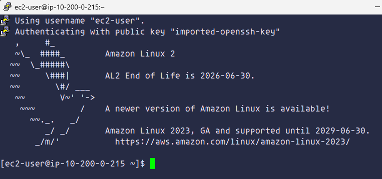
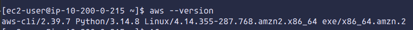
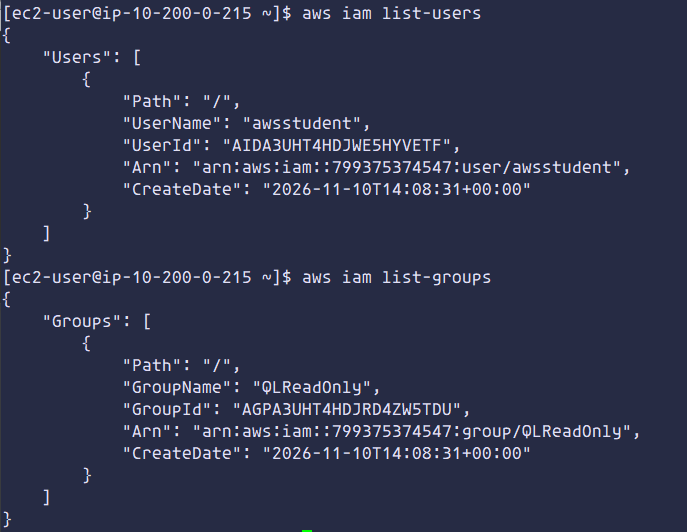
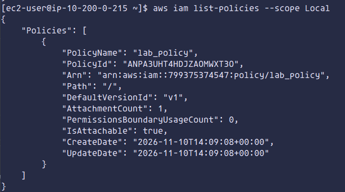
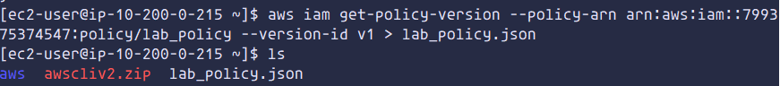

# Lab 168 - Instalar e Configurar a AWS CLI

## Visão geral

Laboratório prático de instalação e configuração da **AWS Command Line Interface (AWS CLI)** em uma instância Amazon EC2, com acesso remoto por SSH.

A atividade permitiu utilizar comandos no terminal para interagir com o AWS Identity and Access Management (IAM).

## 1. Conexão com a instância EC2

Foi estabelecida uma conexão SSH utilizando o PuTTY e a chave privada fornecida pelo ambiente do laboratório.

O acesso remoto permitiu executar comandos diretamente no terminal da instância Linux.



## 2. Instalação da AWS CLI

A AWS CLI foi instalada na instância utilizando o instalador oficial da AWS.

Após a instalação, foi executado o comando `aws --version` para verificar se a ferramenta estava disponível.

<text>Versão instalada: `aws-cli/2.39.7`</text>



## 3. Configuração e acesso ao IAM

A configuração da AWS CLI foi realizada com o comando:

```bash
aws configure
```

Foram configuradas as credenciais de acesso, a região padrão `us-west-2` e o formato de saída `json`.

Com a configuração concluída, foram executados comandos para consultar informações do IAM:

- `aws iam list-users`: consulta os usuários.
- `aws iam list-groups`: consulta os grupos.
- `aws iam list-policies --scope Local`: lista as políticas gerenciadas pelo cliente.





## 4. Desafio - Recuperação de uma política IAM

No desafio, foi utilizada a AWS CLI para recuperar o documento da política `lab_policy` em formato JSON, sem utilizar o Console de Gerenciamento da AWS.

O comando `aws iam get-policy-version` recupera uma versão específica da política. O operador `>` foi utilizado para salvar a saída no arquivo `lab_policy.json`.

O conteúdo do arquivo foi posteriormente consultado no terminal.



## 5. Aprendizados

- Instalação e configuração da AWS CLI em uma instância EC2.
- Acesso remoto a uma instância Linux por SSH.
- Configuração de credenciais e região padrão.
- Utilização de comandos da AWS CLI para consultar recursos do IAM.
- Recuperação de documentos de políticas em formato JSON.
- Redirecionamento da saída de comandos para arquivos.

---

**Material complementar:** a página do projeto apresenta um resumo visual dos conceitos estudados e 8 flashcards interativos para revisão.

[**Acessar página do laboratório**](LINK_DA_GITHUB_PAGES)

*Escola da Nuvem | Fundamentos de Computação em Nuvem AWS*
